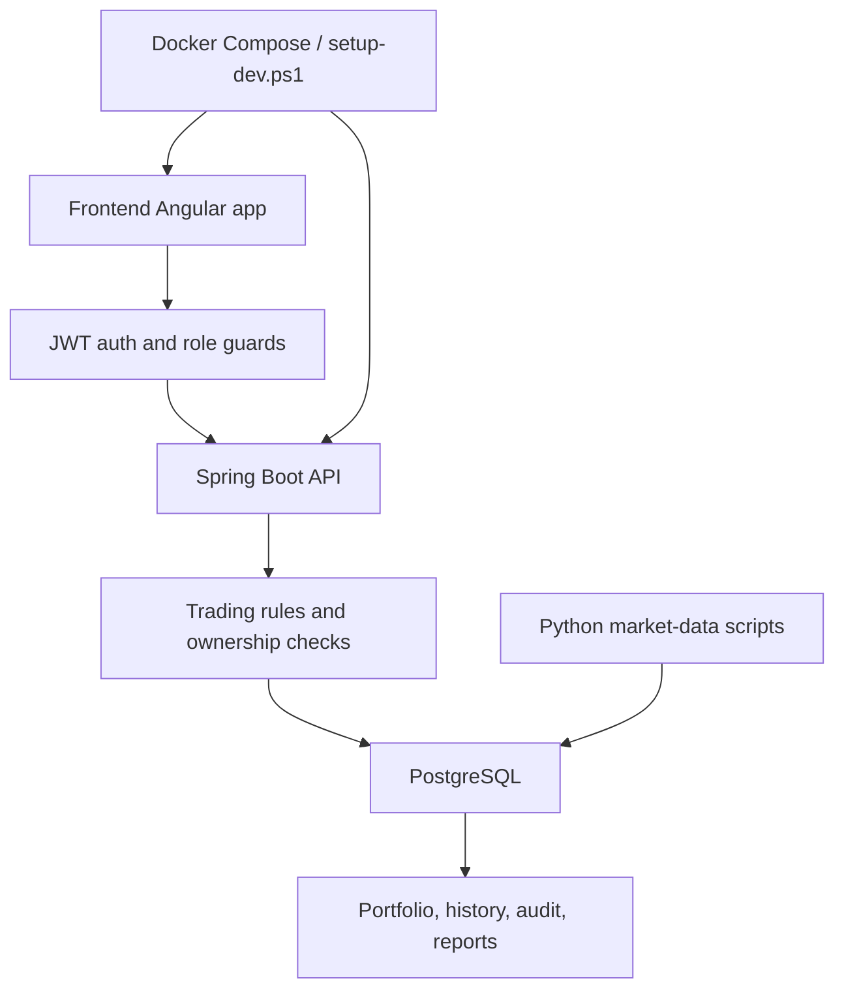

# LEAPvengers

LEAPvengers is a full-stack trading platform MVP built with Angular, Spring Boot, PostgreSQL, Docker, and a small set of Python data scripts. It supports sign-in, role-based navigation, live market data, trading, portfolio views, order history, audit trails, and reporting.

## Team

This project team is:

- Rafid Nasery
- Paula Agyeman
- Samuel Onwukeme
- Bryan Nguyen
- Mark Bounheuangvilay

## At a Glance

- Frontend: Angular 22 with SSR and standalone components
- Backend: Spring Boot on Java 17+
- Database: PostgreSQL
- Market data: Python scripts that backfill Yahoo Finance history and stream live quotes
- Local environments: PowerShell setup script or Docker Compose
- CI/CD: Jenkins and AWS deployment scripts

## How The App Works

The app is built around one main flow:

1. A user signs in or registers on the frontend.
2. The backend issues a JWT and the frontend stores it through the auth service.
3. The shell and route guards show the pages allowed for that user role.
4. The user views portfolio data, prices, order history, audit trails, or reporting pages depending on their role.
5. When a trade is submitted, the backend checks ownership, trading rules, market hours, and price freshness before accepting or rejecting it.
6. Accepted orders are executed against current prices and written to the database together with their audit trail.
7. Background jobs and scripts keep the market data current so the app can show live quotes and historic charts.



## Repository Layout

| Path | Purpose |
| --- | --- |
| [frontend/](frontend/) | Angular application, UI components, routes, guards, services, and styling |
| [backend/](backend/) | Spring Boot API, business logic, security, and persistence |
| [database/](database/) | Schema, seed data, and local database notes |
| [scripts/](scripts/) | Python market-data scripts and container entrypoint helpers |
| [deploy/aws/](deploy/aws/) | AWS infrastructure and deployment scripts |
| [setup-dev.ps1](setup-dev.ps1) | One-command local development bootstrap |
| [start-services.ps1](start-services.ps1) | Windows helper for starting the Docker-based stack |
| [docker-compose.yml](docker-compose.yml) | Full containerized local stack |
| [Jenkinsfile](Jenkinsfile) | CI pipeline |
| [MVP_TEAM_GUIDE.md](MVP_TEAM_GUIDE.md) | Milestone plan and delivery guide |
| [SETUP_GUIDE.md](SETUP_GUIDE.md) | Manual and scripted local setup guide |

## Local Development

### Option 1: One-command Windows setup

Run the setup script from the project root:

```powershell
.\setup-dev.ps1
```

This script:

- checks PostgreSQL
- creates the database
- runs the schema and seed data
- installs Python dependencies
- backfills market prices
- starts the live quote generator
- builds the backend
- installs frontend dependencies
- starts the backend on `http://localhost:8081/api`
- starts the frontend on `http://localhost:4200`

### Option 2: Docker Compose

If you want the whole stack in containers:

```powershell
Copy-Item .env.example .env
docker compose up --build -d
```

Then open:

- Frontend: `http://localhost:8080`
- Backend API: `http://localhost:8081/api`

The first start creates the database, loads the seed data, backfills prices, and starts the backend plus the live feed.

## Demo Users

The seeded demo users use the password `Test123`:

- `joanna` - Trader
- `david` - Ops
- `priya` - Analyst

## Frontend

The frontend is an Angular 22 app with SSR and standalone components. It includes:

- public auth screens for sign-in, register, and password recovery
- a shared app shell with role-based navigation
- dashboard, trade, history, markets, clients, insights, and reports pages
- an auth interceptor that attaches the JWT to API requests
- route guards so signed-out users and wrong-role users are redirected

Key folders:

- [frontend/src/app/layout/](frontend/src/app/layout/)
- [frontend/src/app/pages/](frontend/src/app/pages/)
- [frontend/src/app/services/](frontend/src/app/services/)
- [frontend/src/app/guards/](frontend/src/app/guards/)
- [frontend/src/styles.css](frontend/src/styles.css)

## Backend

The backend is a Spring Boot API that owns authentication, authorization, order validation, execution, audit data, and reporting queries.

It provides:

- JWT sign-in and registration endpoints
- role-based security for Trader, Ops, and Analyst users
- account, portfolio, order, audit, market, and reporting endpoints
- trading rules and execution services
- persistence through Spring Data repositories and PostgreSQL

Key folders:

- [backend/src/main/java/](backend/src/main/java/)
- [backend/src/main/resources/](backend/src/main/resources/)
- [backend/src/test/java/](backend/src/test/java/)

## Scripts

| File | What it does |
| --- | --- |
| [setup-dev.ps1](setup-dev.ps1) | Full local bootstrap: database, seed data, market data, backend, and frontend |
| [start-services.ps1](start-services.ps1) | Starts the Docker-based stack |
| [scripts/yahoo_backfill.py](scripts/yahoo_backfill.py) | Backfills historic prices from Yahoo Finance |
| [scripts/live_quote_generator.py](scripts/live_quote_generator.py) | Streams live quotes into the database while markets are open |
| [scripts/requirements.txt](scripts/requirements.txt) | Python dependencies for the market-data scripts |
| [scripts/docker-entrypoint.sh](scripts/docker-entrypoint.sh) | Container startup helper for the market-data image |

## Useful Commands

### Frontend

```bash
cd frontend
npm install
npm start
npm test
npm run build
```

### Backend

```bash
cd backend
mvn clean install
mvn spring-boot:run
```

### Database

The local schema and seed data live in:

- [database/enterprise-schema.sql](database/enterprise-schema.sql)
- [database/seed.sql](database/seed.sql)

## Application Flow

### Authentication and Roles

- Users sign in through the Angular auth pages.
- The backend returns a JWT with the user identity and role.
- The frontend shell shows only the pages allowed for that role.
- Server-side checks still enforce access, so hiding a link is not the real security boundary.

### Trading Screen

- Users pick an account, instrument, side, and quantity on the trade page.
- The backend checks ownership, trading rules, market hours, and price freshness.
- Accepted orders are executed and recorded together with cash movements and holdings changes.
- Rejected or failed orders remain visible in history and audit views.

### Market Data

- `yahoo_backfill.py` loads historical prices so charts and reporting have a baseline.
- `live_quote_generator.py` keeps current quotes fresh during market hours.
- The backend uses those prices for trade validation and execution.

### Audit and Reporting

- Order events are stored so a user can replay the order timeline.
- Ops users can inspect full trade history and client details.
- Analysts can review aggregated activity without exposing client-level detail in reporting views.

## Deployment Notes

- Local Docker and AWS deployment files live under [deploy/aws/](deploy/aws/).
- The CI pipeline is defined in [Jenkinsfile](Jenkinsfile).
- Environment-specific configuration lives in `backend/src/main/resources/` and `.env.example`.

## Related Docs

- [SETUP_GUIDE.md](SETUP_GUIDE.md)
- [MVP_TEAM_GUIDE.md](MVP_TEAM_GUIDE.md)
- [backend/README.md](backend/README.md)
- [frontend/README.md](frontend/README.md)
- [database/LOCALDB.md](database/LOCALDB.md)
